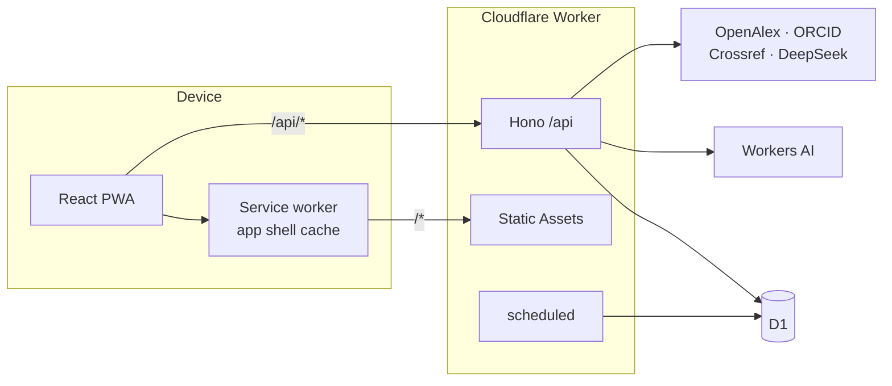
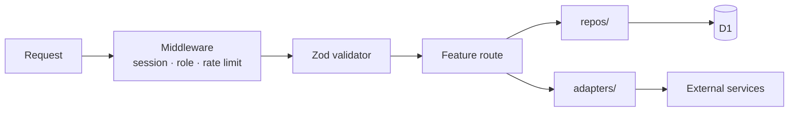
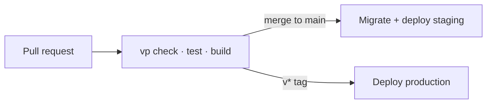

# UniLink

An unofficial, student-run companion PWA for NSU students, whatever their program. It brings course planning, CGPA tracking, class routines, resource sharing, faculty research profiles, rides, lost and found, and a marketplace into one installable app.

## Features

- **Course map**: curriculum with prerequisite checks
- **CGPA & attempts**: graded attempts, retakes and credits
- **Class routine**: weekly schedule with overlap checks
- **Resource sharing**: course notes and links
- **Faculty profiles**: research data from OpenAlex and ORCID, plus an AI supervisor finder
- **Rides, lost and found, marketplace**: community posts that expire on their own
- **Notification inbox** and **moderation**: reports, review queue, audit log

## Tech stack

| Layer     | Tools                                                               |
| --------- | ------------------------------------------------------------------- |
| Toolchain | [Vite+](https://viteplus.dev) (`vp`), pnpm, TypeScript              |
| Client    | React, Tailwind CSS v4, shadcn/ui, TanStack Router + Query          |
| Forms     | React Hook Form + Zod                                               |
| PWA       | `vite-plugin-pwa` (app shell only, data is always fetched live)     |
| API       | Hono on Cloudflare Workers                                          |
| Database  | Cloudflare D1 (SQLite) + Drizzle ORM                                |
| Auth      | Own sessions table, HttpOnly cookie, WebCrypto PBKDF2               |
| AI        | Workers AI (Clef) for screening, DeepSeek for the supervisor finder |
| Jobs      | Cloudflare Cron Triggers                                            |
| CI/CD     | GitHub Actions + Wrangler                                           |

## Architecture

One Cloudflare Worker serves both the API (`/api/*`) and the built PWA through Static Assets, so everything lives on one origin with no CORS. Each environment (local, staging, production) has its own D1 database.



Inside the server, a request flows through fixed layers:



- **Shared schemas** (`src/shared/schemas/`) are used by both client forms and Hono validators, so each shape is defined once.
- **Repositories** (`src/server/repos/`) hold all SQL. Route handlers never build queries.
- **Adapters** (`src/server/adapters/`) wrap every external service behind an interface with a fake, so tests never hit the network.
- **Limits** (caps, cooldowns, expiries, thresholds) all live in `src/server/limits.ts`.

### Layout

```
src/
├── shared/    # Zod schemas and helpers used by client and server
├── server/    # Hono app: features/, middleware/, repos/, db/, limits.ts
└── client/    # React app: routes/, components/, lib/
drizzle/       # generated SQL migrations
scripts/       # seed and admin scripts
docs/          # API contracts
```

### Delivery



## Getting started

```bash
vp install
cp .dev.vars.example .dev.vars
vp run db:migrate:local
vp dev
```

Run `vp check && vp test && vp build` before opening a pull request. See [CONTRIBUTING.md](CONTRIBUTING.md) for the full setup, commands and git workflow, and [docs/api-contracts.md](docs/api-contracts.md) for the API.
