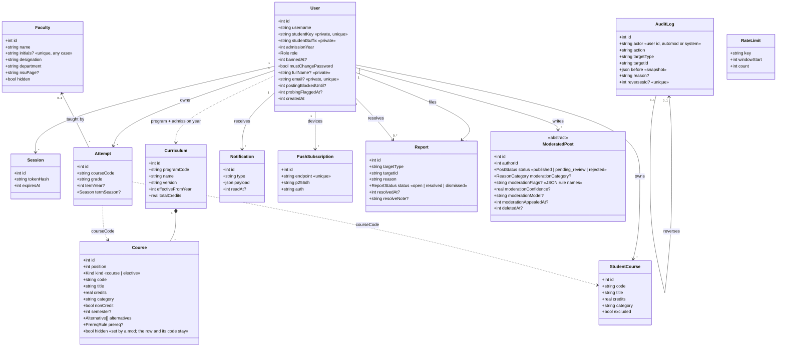
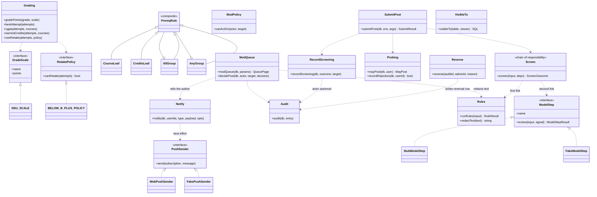

# Class diagram (Phases 0 to 8)

Domain model from `src/server/db/schema.ts`, plus the shared strategy objects and helpers. Times are UTC epoch ms. "Private" fields never appear in a response to anyone but the owner.

## Data model

An attempt refers to a course by code, not by key: the code is a curriculum slot, one of its alternatives, or one of the user's student courses. A report's target is a `(targetType, targetId)` pair so a new post type needs no migration. `ModeratedPost` is the shared column set (`moderationColumns`) every post table spreads in; no concrete post table exists yet, the first is rides.

## Behaviour: strategies and helpers

Patterns in use: Strategy (grade scale, retake policy), Composite (prerequisite rules), Observer entry point (`notify`), Chain of Responsibility (`screen`: rules, then the model step, then a verdict), adapter plus fake (push sender, model step), Repository (`visibleTo` and the post repos). Class names above are conceptual where the code uses plain objects and functions.
