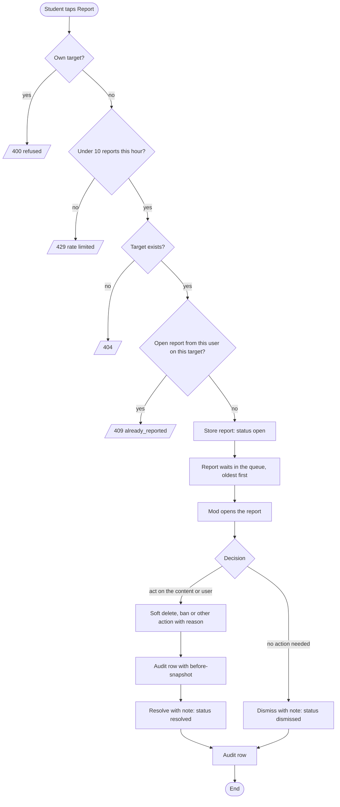
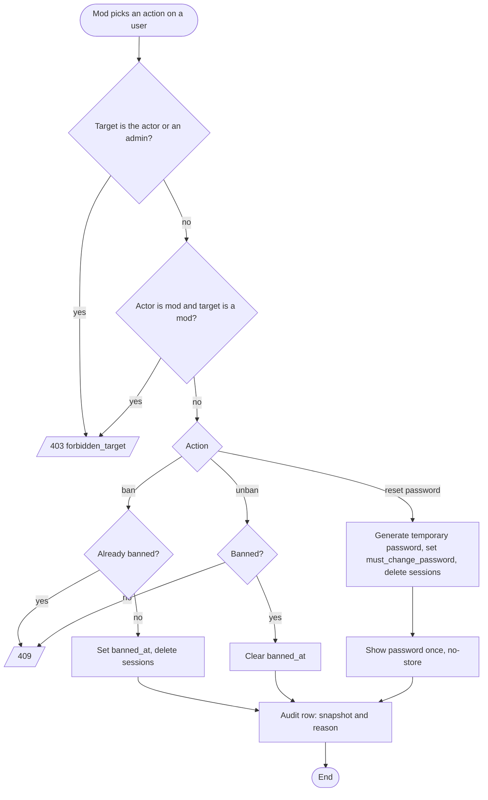
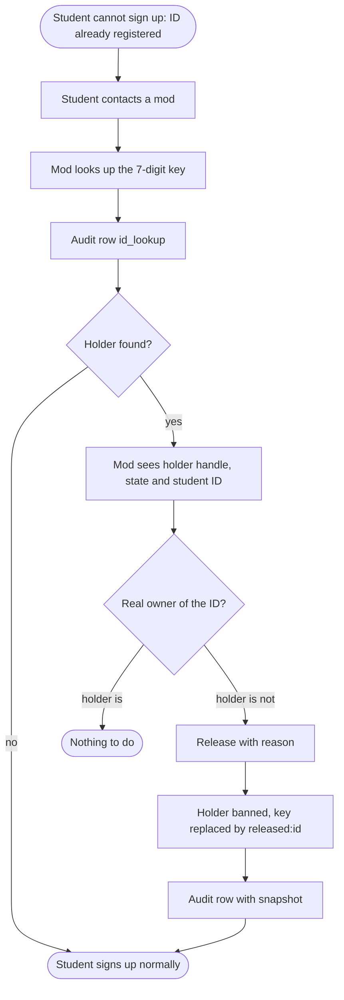
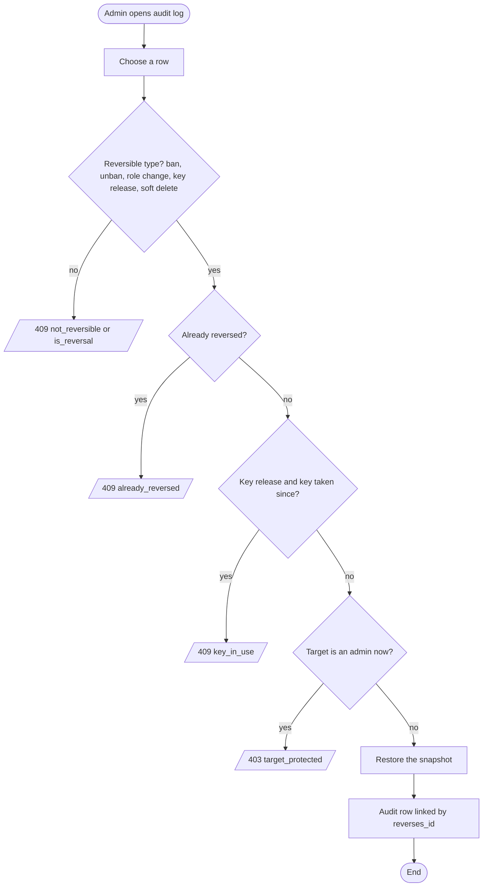

# Moderation flow (activity diagrams)

Covers Phase 7. Held posts from content screening share the queue with reports; see [`screening-flow.md`](screening-flow.md). Every box that changes state writes an audit row.

## Report to resolution

## Acting on a user

## ID conflict

## Admin reversal

