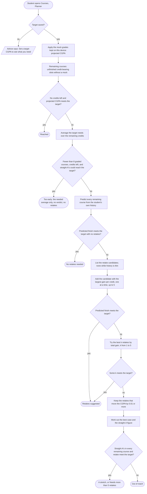
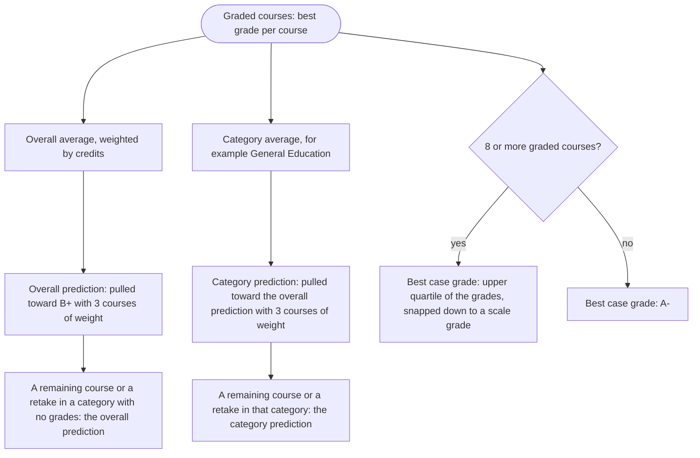

# Grade planner flow (activity diagrams)

Covers the Planner view in Courses. The advice is one pure function, `adviseRetakes()` in `src/shared/planner.ts`, built on the CGPA and retake rules in `src/shared/grading.ts`. It runs in the browser: the only thing sent to the server is the target CGPA (`PUT /api/attempts/target`). Mock grades stay on the device. Nothing here uses AI or sends a notification.

All the numbers below (8 graded courses, B+ as the starting average, 3 courses of weight, at most 5 retakes, 0.01 minimum effect) are named values in `src/shared/planner.ts`, re-exported from `src/server/limits.ts`.

## From target to advice

Rules the diagram relies on:

- **Needed average** is worked out per course record, not on totals: `(target × (graded credits + new credits) − points so far) ÷ remaining credits`. A remaining course that already has an F is in the CGPA at 0.0, so passing it adds points but no graded credits.
- **Too early.** With fewer than 8 graded courses, predictions are mostly the starting average (B+), so there is no verdict. A target that even straight A's with retakes cannot reach skips this step and ends as out of reach, with no retakes listed: that is arithmetic, not a prediction.
- **Retake candidate.** The retake policy allows it (best grade below B+), the course is graded and credit-bearing, it has no mock, it is not one of the remaining courses, it is not waived, and its predicted grade, to the nearest scale grade, beats its best grade (so a retake never reads `B → B`). A failed extra course is a candidate; a required course whose only grade is F is not, because it has to be passed anyway.
- **Remaining F-only course.** It has to be passed, so it is predicted no lower than the lowest passing grade (D).
- **Order.** The largest gain per credit first (grade points of the shown grade minus the current best), then more credits, then course code.
- **Stretch or out of reach.** The straight-A figure (`maxCgpa`) puts the top grade in every remaining course and every eligible retake. If that meets the target the outcome reads "A stretch" (or "Needs more than 5 retakes" when all the candidates together would meet the target at predicted grades). If not, it reads "Out of reach".

## How a grade is predicted

F counts at 0.0. I, W, WV, non-credit and excluded courses are not part of the history, and mock grades never are. The best case scores each course at the higher of its prediction and the best case grade, so it never falls below the predicted finish.

## What the panel says

| Outcome (`kind`)    | Panel title                                               | Sentence                                                                                                                                                                 |
| ------------------- | --------------------------------------------------------- | ------------------------------------------------------------------------------------------------------------------------------------------------------------------------ |
| `reached`           | "Target reached", or "Reached with your mock grades"      | "Target reached."                                                                                                                                                        |
| `too_early`         | "Too early to call"                                       | "You need about a 3.66 average in your remaining 27 credits." (with the real figures); "Any passing grades get you there."; "You'd need retakes on top of straight A's." |
| `no_retakes_needed` | "No retakes needed"                                       | "On track without retakes."                                                                                                                                              |
| `retakes_suggested` | "One retake would help" or "A few retakes would help"     | "Retaking 1 course gets you there." or "Retaking 3 courses gets you there."                                                                                              |
| `out_of_reach`      | "A stretch", "Out of reach", or "Too many retakes needed" | "A stretch: you'd need grades well above your usual."; "Out of reach by graduation."; "Needs more than 5 retakes."                                                       |

Every outcome except `reached` and `too_early` also shows "Predicted at graduation", "Needed in your remaining N credits" (written "over 4.00" above 4.00 and "Any passing grade" at or below 0) and "Your usual average there". Out of reach adds "Best case" and "Straight A's". Under them: the line saying what the predictions rest on, and "Estimates only. Retake rules and fees are set by NSU."
