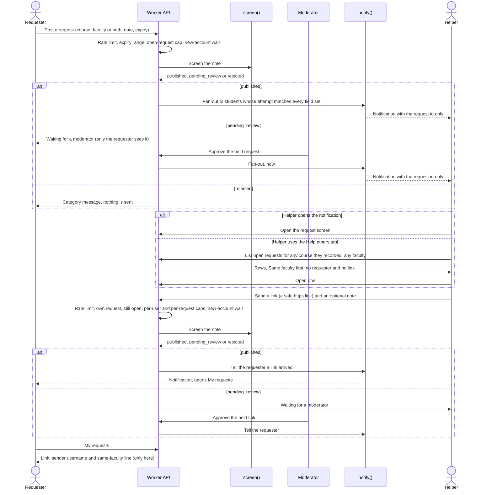
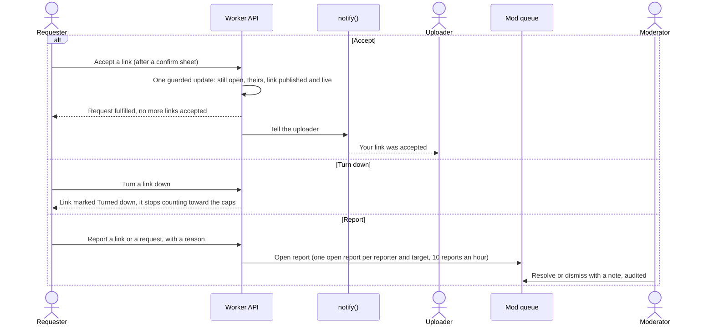
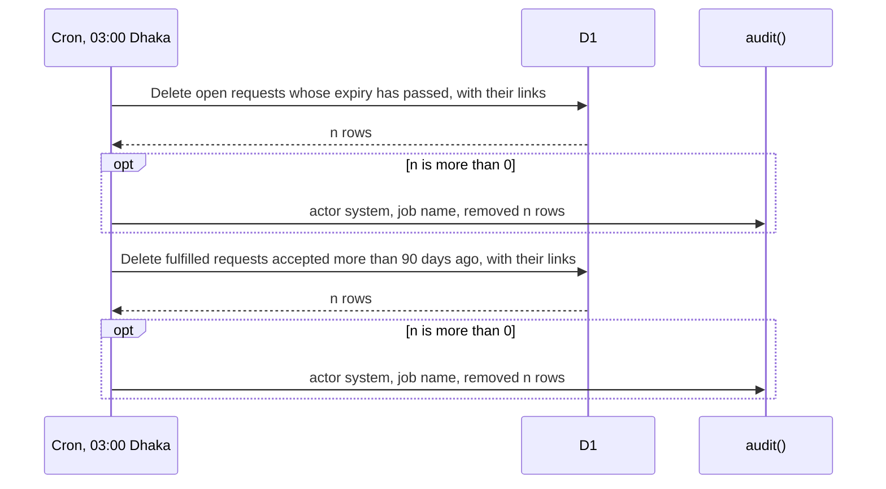

# Resource sharing flow (sequence diagrams)

Covers material requests and the links sent to them. Code: `src/server/features/resources/` (routes, `announce.ts`, `postTypes.ts`), `src/server/repos/resources.ts`, `src/server/cron.ts`, `src/shared/resourceUrl.ts`. Links only: UniLink hosts no files.

Both a request and a link are user-written posts, so each goes through `submitPost()` and `screen()` (see [`screening-flow.md`](screening-flow.md)). The URL itself is checked by one shared rule (`resourceUrl.ts`, used by the form and again by the server): a full `https` link to a public website, with link shorteners and private or numeric hosts refused.

## Request, notification and link

Who is told: every student whose attempts match **every field the request sets** (the course, the faculty member, or both on the same attempt), once each, excluding the requester and banned users, up to `limits.resourceFanoutMax`. The requester is never told who or how many. Help others works the other way round: it lists open requests when the helper looks, so a course recorded after the request was posted still shows it. Notifications are not sent again.

## Accept, turn down, report

Taking content down is a soft delete with an audit row (`softDelete()` in `src/server/softDelete.ts`); an admin can reverse it, and the row is never hard-deleted by a mod. The report row in the queue offers only Mark handled and Dismiss so far: there is no button that calls `softDelete()` yet.

The uploader is not told when a link is turned down. A helper who has opened a request can also report it from the request screen. Only the requester can report a link, and only once it is published; a request is reportable by anyone who can see it.

## Expiry and purge

- **Expiry.** The requester picks it (1, 3, 7, 14 or 30 days; the server accepts 1 hour to 60 days). A request past its expiry is shown as expired and takes no links straight away, before the cron removes it. It also drops out of Help others and stops being visible to everyone but its requester.
- **After accepting.** A fulfilled request and its links stay for 90 days (shown as "3 months" in the screens), so the requester can save what they need. Then the cron deletes them.
- **Schedule.** The cron trigger is `0 21 * * *` in UTC, which is 03:00 in Asia/Dhaka. Hard deletion happens only here; mods only soft-delete.
- **Held and rejected requests** that pass their expiry are deleted too: the first job removes every unfulfilled request past its expiry, whatever its screening status.
