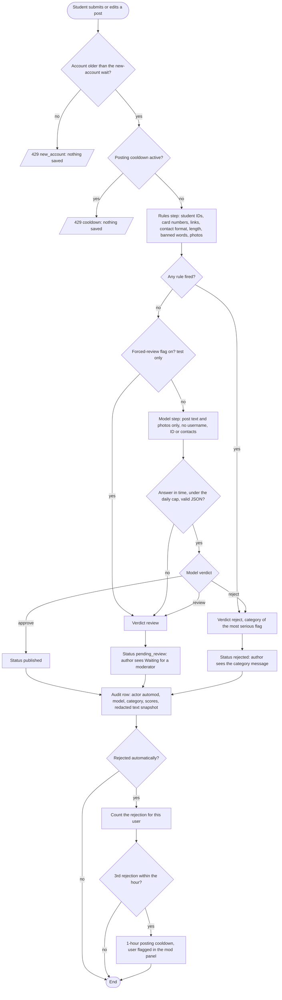
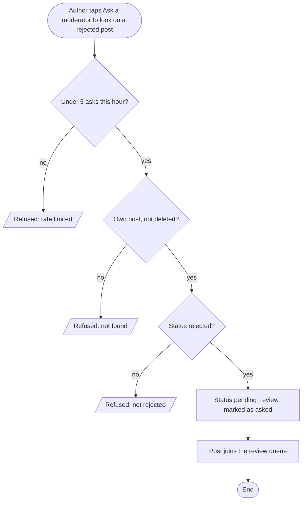
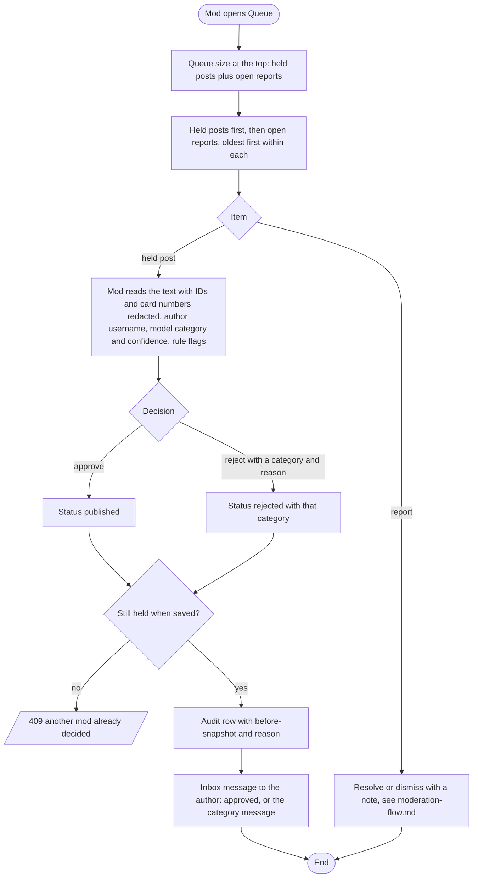
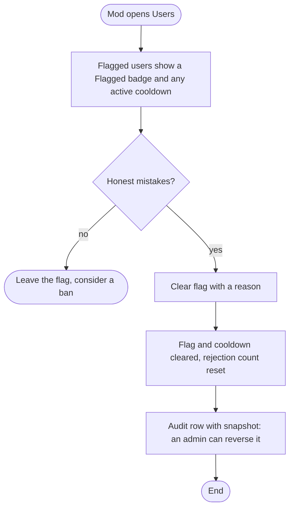

# Post screening flow (activity diagrams)

Covers content screening and the review queue. Every user-written post (rides, lost and found, marketplace, resource requests and submissions) goes through these flows on create **and** on any edit that changes screened text or photos. Code: `src/server/moderation/` (`submitPost()`, `screen()`, `runRules()`, `askModerator()`) and `src/server/features/mod/` (`modQueue()`, `decidePost()`).

Statuses on every post: `published`, `pending_review`, `rejected`. A post that is not published is visible only to its author and to mods. Every automatic decision writes an audit row with actor `automod`.

## Submit or edit a post

Fail safe: a model error, timeout, malformed answer or the daily cap holds the post for a mod. Unscreened text is never published automatically and never rejected automatically. The rules still apply. Until the real model arrives, the stub step approves text and holds any post with photos.

## Ask a moderator to look

Each post type exposes this through its own route (from rides onwards). Editing instead of asking runs the post through the full screening flow again and clears the ask.

## Review queue

The mod's decision overrides the model. The author never sees the mod's reason, the model's scores or which rule fired, only the category message from [`reject-reasons.md`](reject-reasons.md).

## Probing flag

