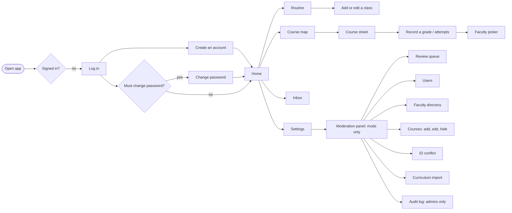

# Screens and flows (mobile-first)

The screen specification for what is built through Phase 9. It records each flow, what every screen shows, and its states (loading, empty, error) at phone width (390px). It replaces the planned Figma file: the screens were designed straight in code against [`DESIGN.md`](../DESIGN.md), so this document and the running app are the reference. Desktop (1440px) uses the same screens in a wider centred column, with the bottom bar moved into the top header.

Shared rules on every screen (from `PRODUCT.md` and `DESIGN.md`):

- Quiet Utility: neutral grounds, hairline-separated lists, one accent per palette, no gradients, glass or resting shadows. Geist, with Noto Sans Bengali for Bangla.
- Every action result and error is a toast. Inline text only for per-field validation. Moderation states use a persistent `StatusNote`.
- Touch targets are at least 44px. Everything works with the keyboard.
- Student IDs, emails and full names are never shown to other students.

## App flow

Navigation:

- **Main tabs.** A bottom bar on phones, the top bar from `md`. Students: Home, Courses, Routine, Inbox (unread badge), Settings. Mods and admins: Home, Courses, Inbox, Mod, Settings; the Mod tab opens the moderation panel and stays marked while any `/mod/...` screen is open. Mods and admins get Mod in place of Routine so the bar never goes past five; they reach their own routine from Home ("Full routine"). Students never see Mod. The current tab is marked by `aria-current` and heavier ink. Moderation is also still listed under Settings.
- **No tabs when they would lead nowhere.** Log in, Create an account and the forced Change password screen show only the wordmark; the tabs return once the user is signed in and has no temporary password.
- **Moderation sections.** From `md`: an underline tab row (Queue, Users, Faculty, Courses, ID check, Audit log for admins, Import). On a phone seven sections do not fit a row, so the screen shows "Moderation" with a button naming the current section; it opens a bottom sheet listing every section the role can open, each with a one-line hint. The current row is tinted and ticked (`aria-current="page"`), and choosing a row closes the sheet.
- **Back paths.** Mod sections are peers of one top-level panel, so they need no back. Change password, opened from Settings, shows "Settings" with a back chevron above its title (not while the change is forced). Sheets (course sheet, pickers, mod sheets) close with their X, Esc or a tap on the scrim.

App-wide states: "You're offline" full screen with Retry when there is no connection; "A new version is ready" toast with a reload action after an update; an "Add to Home Screen" hint on iOS Safari that can be dismissed.

## Log in and sign up (Phase 2)

### Log in (`/login`)

| Element      | Notes                                                              |
| ------------ | ------------------------------------------------------------------ |
| Title        | "Log in"                                                           |
| Fields       | Username, Password                                                 |
| Primary      | Log in                                                             |
| Secondary    | Link to "Create an account"                                        |
| Errors       | Wrong username or password, rate limited, banned: one toast each   |
| After log in | Home, or Change password when `must_change_password` is set (FR-6) |

### Create an account (`/signup`)

| Field          | Notes                                                                                          |
| -------------- | ---------------------------------------------------------------------------------------------- |
| Username       | 3 to 20 lowercase letters, digits, underscore. Shown to others.                                |
| Full name      | Helper: "Private. Other students never see it."                                                |
| NSU email      | Must end in `@northsouth.edu`. Helper: "Private. Other students never see it."                 |
| NSU student ID | Placeholder `221 1234 042`; spaces and dashes are fine. Inline error names the problem (FR-2). |
| Password       | 8 to 128 characters                                                                            |

Primary: Create account. Errors: ID already registered (with a pointer to ask a mod, see the ID conflict flow), username taken, signup limit reached. Validation runs from the shared Zod schema, field by field.

### Change password (`/change-password`)

Current password and New password. Reached by choice from Settings, or forced after a mod reset or on the seeded admin's first login; while forced, every other screen redirects here.

## Course map (Phase 4)

### Home (`/`)

- "Welcome to UniLink" header with the CGPA summary (CGPA, earned and remaining credits, a credit bar).
- "Unlocked next" with its count and a "Course map" link: the first six courses whose prerequisites are now met, each with its state mark. When there are more, a muted "Showing 6 of 12" line ends the list.
- Empty: "No course map for your program yet. It will show up here once a moderator adds it. Your progress starts counting then."
- Error: "Couldn't load your progress. Check your connection and try again."

### Course map (`/courses`)

- Header "Course map" with the CGPA summary.
- Degree credits (earned of required, with any credits over the total) and a credit bar, then a "Categories" jump list: each category with its earned and required credits and its own credit bar (names come from the curriculum file, such as General Education, Math & Science, Major Core). Below it, one hairline list per category.
- Each row: state mark, code, title, credits. **Choice slots:** a slot that accepts more than one course shows every code joined with "/" (the slot code first, then its alternatives, for example `ENG115/BEN205`) and the titles joined with " / ", wrapping onto two lines at 390px, until the student records an attempt on one of them. After that the row shows that course's code and title. If several of the codes have attempts, the course that counts is shown: a passing attempt over a failed one, then the better best grade, then the most recent attempt. Lab slots (`CSE115L`) work the same way. "Unlocked next" on Home and the course sheet header use the same label. A course a moderator has hidden is not in the list, unless the student already has a grade on it. State marks are shape-coded, never colour alone: filled = done, hollow = available, struck = locked, half = waived. A "Can retake" tag shows where the retake policy allows it.
- "Your extra courses" section lists the student's own electives and extras; excluded ones carry an "Excluded" tag.
- "Add a course" opens the student course form: Course code (cannot change once added), Title, Credits, Category, "Exclude from transcript". Helper: "It fills the next open elective in its category."
- Empty: "No course map for your program yet".

### Course sheet

A bottom sheet on phone, side panel on desktop, opened from any course row.

- Code, title, credits, "Non-credit" tag when it applies, the prerequisite rule in words, and "Or take instead" alternatives. For a choice slot the header shows the joined codes and titles until one is taken; afterwards it shows the course taken, and the list is titled "Other choices for this slot".
- Locked course: "You haven't met the prerequisites yet." Recording a grade still works (students fix data that way).
- Waiving: record the grade "WV". The course counts as done and earns credits, never affects CGPA, and shows the half mark.
- Own courses add Edit and "Delete course".

## CGPA and attempts (Phase 6)

Inside the course sheet, under "Your attempts":

| State       | What shows                                                                                                  |
| ----------- | ----------------------------------------------------------------------------------------------------------- |
| No attempts | "Record a grade": quick form with Grade only ("Pick a grade"), and "Add term and faculty" for the full form |
| Attempts    | One row per attempt: grade, term, faculty; the counting one is tagged "Best"; Edit and "Delete attempt"     |
| Retake      | "Retake allowed" or "Retake not allowed" from the retake policy                                             |
| Add another | "Add an attempt" opens the full form                                                                        |
| Loading     | "Loading your attempts..."                                                                                  |
| Error       | "Your attempts did not load. You can still record a grade."                                                 |

Full attempt form: Course, Grade, Term (optional, "Pick the term you took it in."), Faculty (optional; a picker, see below; if the list fails to load the control is disabled and a toast says "The faculty list did not load. You can save without it."). Buttons: "Save grade" (quick), "Save attempt" (new), "Save changes" (edit). Toasts: "Grade saved", "Attempt updated", "Attempt deleted".

**Faculty picker.** The Faculty field is a button showing the chosen "Name (INITIALS)" or "No faculty". Tapping it opens a bottom sheet (centred on desktop) titled "Who taught it?" with a search box ("Search by name or initials", focused on open), a department filter ("All departments" or one department) and a hairline list. The first row is "No faculty". Each row shows the name with initials in brackets (no brackets when the person has none) and a muted line "designation · department". The chosen row is tinted and ticked. Search matches the start of any name word, or the start of the initials, without regard to case or accents, and ignores titles like "Dr."; exact initials rank first. Empty result: "No faculty match that search." Keyboard: type, Arrow up/down to move, Enter to pick, Esc to close. The list is fetched once and searched in the browser. A faculty member a moderator has hidden is not in the list, but an attempt that already names them keeps showing the name. Attempt rows show "Name (INITIALS)".

CGPA summary (Home and Course map): the CGPA to two decimals, or "No CGPA yet"; Earned and Remaining credits; a credit bar; "Every category has its credits." once nothing remains. Only the student sees their attempts and CGPA; mods cannot.

## Class routine (Phase 9)

Everyone has their own routine, mods and admins included (they reach it from Home, since the Mod tab takes the Routine tab's place). Nobody else ever sees a user's routine, mods and admins included, and it is never used for notifications. Times are Asia/Dhaka.

### Home: next class and Today

- **Summary panel.** While a class is on, it reads "In class now" with the minutes left ("left in this class"); otherwise, if a class is still to come today, "Next class" with the minutes until it starts ("until it starts"). Below: the course code and title, the time range, and "Section 2 · Room 304 · RkZ". With no class left today, or no routine, the panel shows the degree standing as before (credits, credit bar, "Record a grade"). While the routine loads, a flat placeholder holds the panel's place so it does not swap.
- **Today.** A section header "Today" with a "Full routine" link, then today's classes in time order on a time rail: start and end on the left, a hairline, then the course, title and details. The class in progress sits on a `brand-soft` row marked "Now"; finished classes are in `faint` ink (and say "Finished" to screen readers), so neither state is colour alone. The clock refreshes every 30 seconds and when the app comes back to the foreground.
- Empty (no routine): "Add the classes you're taking this term and today's will show up here." with an "Add your routine" link. No class today: "No classes today." Loading: two flat placeholder rows. Error: "Today's classes didn't load. Check your connection and try again." with Retry.

### Routine (`/routine`)

A calendar of the current term, like a phone's calendar app, with Month, Week and Day views. The routine repeats every week of the term, so each date shows the classes held on its weekday. The view and date are in the URL (`?view=month&date=2026-10-21`); Week and today are the defaults.

- Header "Routine" with the current term (for example "Fall 2026") and the one primary button, "Add class".
- A row with the view switch (Month · Week · Day, a segmented control) and "Today" (disabled while today is shown). Under it the period on screen ("October 2026", "Oct 18 - 24", "Wednesday, Oct 21") with back and forward arrows: a month, a week or a day at a time.
- **Week** (the default): a time grid, Sunday to Saturday, 8 AM to 6 PM (wider when a class starts earlier or ends later), one hairline per hour. Each column header shows the weekday and date; today's date sits on a `brand-soft` chip, and tapping a header opens that day. Classes are blocks at their times: the code (and on wider screens the time and room); classes on now are `brand-soft` with a brand edge, finished ones are faint, and a thin brand line marks the current time in today's column. Classes that clash share their slot side by side; on a phone those narrow blocks drop their text, and the full label is read out and shown in the sheet. Tapping a block opens Edit class; tapping an empty slot opens "Add a class" with that day and time filled in (a 90-minute class from the nearest half hour).
- **Day**: the same grid for one date, with each block showing the code and title, the time range and "Section 2 · Room 304 · RkZ".
- **Month**: whole weeks covering the month, Sunday first. Each date shows its classes: on wider screens up to three as "8:00 AM CSE115" with "N more" after, on a phone one short bar per class. Other months' dates are faint; today's date sits on a `brand-soft` chip. Tapping a date opens it in Day.
- Dates outside the term have no classes; a day outside it says "This day is outside Fall 2026, so it has no classes." Term dates come from the shared term start dates until moderators can set each term's start and end.
- No classes at all: "No classes yet. Add the ones you're taking this term, or tap an empty slot on the grid." A day with none: "No classes this day."
- "Clear this term" (only when there are classes) asks first: "Clear this term's routine?" / "This deletes all N classes from this term. It can't be undone." with "Keep them" and "Clear routine". Toast "Routine cleared".
- Loading: a flat placeholder at the grid's size. Error: "Your routine didn't load" with the reason and "Try again".

### Class sheet

A bottom sheet titled "Add a class" or "Edit class", with "Times are Dhaka time. Only you can see your routine."

| Field              | Notes                                                                                                                                                                                                                                                                                                                                                                                                                                                                                                                                                                                                                                     |
| ------------------ | ----------------------------------------------------------------------------------------------------------------------------------------------------------------------------------------------------------------------------------------------------------------------------------------------------------------------------------------------------------------------------------------------------------------------------------------------------------------------------------------------------------------------------------------------------------------------------------------------------------------------------------------- |
| Course             | A field showing the chosen code and title ("Pick a course" when empty). It opens a sheet, "Which course is this class?", with a search box ("Search by code or title", focused) over the student's curriculum courses, alternatives and own courses. Each row shows its state mark, code and title; courses the student can take now come first, then locked ones, then done ones. Search matches a code with or without spaces ("cse 2", "cse225", "115") or the start of title words ("data struct"). Arrow keys and Enter pick; "No course matches that search." when nothing does. A saved class whose course left the list keeps it. |
| Section            | A number, 1 to 99                                                                                                                                                                                                                                                                                                                                                                                                                                                                                                                                                                                                                         |
| Days               | Seven toggles with the letters NSU prints: S M T W R F A. Helper: "The letters NSU prints: S is Sunday, R is Thursday, A is Saturday." "Pick at least one day" when none                                                                                                                                                                                                                                                                                                                                                                                                                                                                  |
| Starts, Ends       | Times; "Pick a start time", "Pick an end time"; the end must be after the start                                                                                                                                                                                                                                                                                                                                                                                                                                                                                                                                                           |
| Room (optional)    | Free text as printed on the NSU routine                                                                                                                                                                                                                                                                                                                                                                                                                                                                                                                                                                                                   |
| Faculty (optional) | Faculty initials as printed on the NSU routine, free text (not the faculty picker)                                                                                                                                                                                                                                                                                                                                                                                                                                                                                                                                                        |

When the days and times clash with another class: "This overlaps another class. You can still save it." naming each clashing class, its days and its time. It never blocks saving; touching times (one ends at 10:00, the next starts at 10:00) are not a clash. Buttons: "Add class" / "Save changes"; on an existing class, "Delete class" asks "Delete this class from your routine?" first. Toasts: "Class added", "Class updated", "Class deleted".

## Moderation panel (Phases 7 and 8)

- **Review queue** (`/mod/queue`): "Review queue" with the waiting count. Tabs: Waiting, Handled, Dismissed. Waiting mixes held posts and open reports. A held post row shows the text (IDs and card numbers redacted), the author's username, the model category and confidence, "Rules that matched", and "The author asked a moderator to look at this." when it applies. Actions: Approve, Reject (category plus reason). Report rows: Mark handled or Dismiss with a note. Empty: "Nothing is waiting for you."
- **Users**: search by username prefix; rows show handle and state badges (Banned, Flagged); the user sheet offers Ban, Unban, Reset password and Clear flag, each with a reason.
- **Faculty** (`/mod/faculty`, mods and admins): "Faculty" with an "Add faculty" button. The same search and department filter as the picker, plus a "Show hidden" switch (with the hidden count); rows show name (initials), "designation · department" and a "Hidden" badge. Tapping a row (or "Add faculty") opens a sheet with Name, Initials (optional), Designation, Department and NSU page (optional); "Save changes" / "Add faculty". Taken initials show under Initials, a taken name under Name. Existing rows also have a Visibility section: a required reason and "Hide" (or "Show again" for a hidden row). Toasts: "Faculty added", "Faculty updated", "Faculty hidden", "Faculty shown again". Empty: "No faculty match that search." Every change is in the audit log; admins can reverse an edit or a hide.
- **Courses** (`/mod/courses`, mods and admins): "Courses" with a curriculum picker (program and version, from the imported curricula), an "Add course" button, a search box ("Search by code or title", which also matches alternatives) and a "Show hidden" switch (with the hidden count). The slots are listed by category in curriculum order; each row shows the title, the code (joined with its alternatives), "elective", the semester, the credits and a "Hidden" badge. Each category header has "Add here". Tapping a row opens a bottom sheet with Kind (course or elective placeholder), Code, Title, Credits (halves like 1.5), Non-credit, Category (pick one or "New category..."), Semester (optional), "Or take instead" (code and title pairs, added and removed one by one; courses only) and Prerequisites as text (`CSE215 and (MAT120 or MAT125)`, `60 credits completed`; empty for none). A text mistake or a prerequisite on a course the curriculum doesn't have shows under Prerequisites; a code already used by another slot shows under Code. Existing rows also have a Visibility section: a required reason and "Hide" (or "Show again"); a hidden course leaves students' maps unless they already have a grade on it, and grades are never deleted. Toasts: "Course added", "Course updated", "Course hidden", "Course shown again". Empty: "No courses found". Every change is in the audit log; admins can reverse an edit, a hide or a show.
- **ID conflict**, **Curriculum import** and **Audit log** (admins: filter, Reverse) as described in [`moderation-flow.md`](moderation-flow.md). When the chosen file's program and version are already imported, the import screen shows a note: "Importing replaces every course of this version, including changes made in the Courses screen." The intro text says the same.

Flows for screening and the queue are in [`screening-flow.md`](screening-flow.md).
