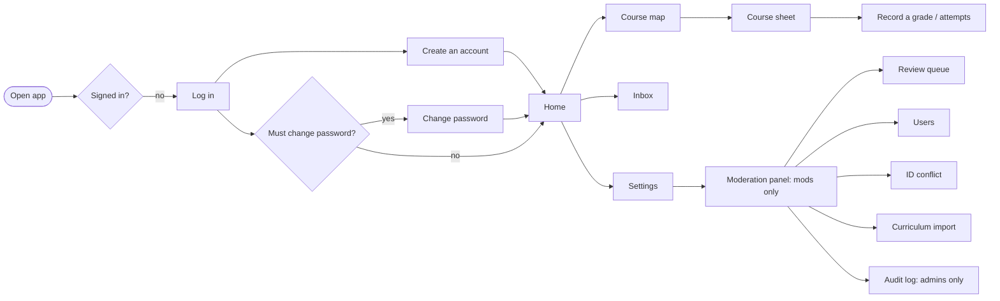

# Screens and flows (mobile-first)

The screen specification for what is built through Phase 8. It records each flow, what every screen shows, and its states (loading, empty, error) at phone width (390px). It replaces the planned Figma file: the screens were designed straight in code against [`DESIGN.md`](../DESIGN.md), so this document and the running app are the reference. Desktop (1440px) uses the same screens in a wider centred column, with the bottom bar moved into the top header.

Shared rules on every screen (from `PRODUCT.md` and `DESIGN.md`):

- Quiet Utility: neutral grounds, hairline-separated lists, one accent per palette, no gradients, glass or resting shadows. Geist, with Noto Sans Bengali for Bangla.
- Every action result and error is a toast. Inline text only for per-field validation. Moderation states use a persistent `StatusNote`.
- Touch targets are at least 44px. Everything works with the keyboard.
- Student IDs, emails and full names are never shown to other students.

## App flow

Navigation: a bottom bar with Home, Courses, Inbox (unread badge) and Settings. The Moderation panel is reached from Settings and is hidden from students.

App-wide states: "You're offline" full screen with Retry when there is no connection; "A new version is ready" toast with a reload action after an update; an "Add to Home Screen" hint on iOS Safari that can be dismissed.

## Log in and sign up (Phase 2)

### Log in (`/login`)

| Element      | Notes                                                              |
| ------------ | ------------------------------------------------------------------ |
| Title        | "Log in"                                                           |
| Fields       | Username, Password                                                 |
| Primary      | Log in                                                             |
| Secondary    | Link to "Create an account"                                        |
| Errors       | Wrong username or password, rate limited, banned: one toast each   |
| After log in | Home, or Change password when `must_change_password` is set (FR-6) |

### Create an account (`/signup`)

| Field          | Notes                                                                                          |
| -------------- | ---------------------------------------------------------------------------------------------- |
| Username       | 3 to 20 lowercase letters, digits, underscore. Shown to others.                                |
| Full name      | Helper: "Private. Other students never see it."                                                |
| NSU email      | Must end in `@northsouth.edu`. Helper: "Private. Other students never see it."                 |
| NSU student ID | Placeholder `221 1234 042`; spaces and dashes are fine. Inline error names the problem (FR-2). |
| Password       | 8 to 128 characters                                                                            |

Primary: Create account. Errors: ID already registered (with a pointer to ask a mod, see the ID conflict flow), username taken, signup limit reached. Validation runs from the shared Zod schema, field by field.

### Change password (`/change-password`)

Current password and New password. Reached by choice from Settings, or forced after a mod reset or on the seeded admin's first login; while forced, every other screen redirects here.

## Course map (Phase 4)

### Home (`/`)

- "Welcome to UniLink" header with the CGPA summary (CGPA, earned and remaining credits, a credit bar).
- "Unlocked next": the courses whose prerequisites are now met, each with its state mark, linking to the course sheet.
- Empty: "No course map for your program yet. It will show up here once a moderator adds it. Your progress starts counting then."
- Error: "Couldn't load your progress. Check your connection and try again."

### Course map (`/courses`)

- Header "Course map" with the CGPA summary.
- Degree credits (earned of required, with any credits over the total) and a credit bar, then a "Categories" jump list: each category with its earned and required credits and its own credit bar (names come from the curriculum file, such as General Education, Math & Science, Major Core). Below it, one hairline list per category.
- Each row: state mark, code, title, credits. State marks are shape-coded, never colour alone: filled = done, hollow = available, struck = locked, half = waived. A "Can retake" tag shows where the retake policy allows it.
- "Your extra courses" section lists the student's own electives and extras; excluded ones carry an "Excluded" tag.
- "Add a course" opens the student course form: Course code (cannot change once added), Title, Credits, Category, "Exclude from transcript". Helper: "It fills the next open elective in its category."
- Empty: "No course map for your program yet".

### Course sheet

A bottom sheet on phone, side panel on desktop, opened from any course row.

- Code, title, credits, "Non-credit" tag when it applies, the prerequisite rule in words, and "Or take instead" alternatives.
- Locked course: "You haven't met the prerequisites yet." Recording a grade still works (students fix data that way).
- Waiving: record the grade "WV". The course counts as done and earns credits, never affects CGPA, and shows the half mark.
- Own courses add Edit and "Delete course".

## CGPA and attempts (Phase 6)

Inside the course sheet, under "Your attempts":

| State       | What shows                                                                                                  |
| ----------- | ----------------------------------------------------------------------------------------------------------- |
| No attempts | "Record a grade": quick form with Grade only ("Pick a grade"), and "Add term and faculty" for the full form |
| Attempts    | One row per attempt: grade, term, faculty; the counting one is tagged "Best"; Edit and "Delete attempt"     |
| Retake      | "Retake allowed" or "Retake not allowed" from the retake policy                                             |
| Add another | "Add an attempt" opens the full form                                                                        |
| Loading     | "Loading your attempts..."                                                                                  |
| Error       | "Your attempts did not load. You can still record a grade."                                                 |

Full attempt form: Course, Grade, Term (optional, "Pick the term you took it in."), Faculty (optional; the list shows name and designation; if it fails to load a toast says "The faculty list did not load. You can save without it."). Buttons: "Save grade" (quick), "Save attempt" (new), "Save changes" (edit). Toasts: "Grade saved", "Attempt updated", "Attempt deleted".

CGPA summary (Home and Course map): the CGPA to two decimals, or "No CGPA yet"; Earned and Remaining credits; a credit bar; "Every category has its credits." once nothing remains. Only the student sees their attempts and CGPA; mods cannot.

## Moderation panel (Phases 7 and 8)

- **Review queue** (`/mod/queue`): "Review queue" with the waiting count. Tabs: Waiting, Handled, Dismissed. Waiting mixes held posts and open reports. A held post row shows the text (IDs and card numbers redacted), the author's username, the model category and confidence, "Rules that matched", and "The author asked a moderator to look at this." when it applies. Actions: Approve, Reject (category plus reason). Report rows: Mark handled or Dismiss with a note. Empty: "Nothing is waiting for you."
- **Users**: search by username prefix; rows show handle and state badges (Banned, Flagged); the user sheet offers Ban, Unban, Reset password and Clear flag, each with a reason.
- **ID conflict**, **Curriculum import** and **Audit log** (admins: filter, Reverse) as described in [`moderation-flow.md`](moderation-flow.md).

Flows for screening and the queue are in [`screening-flow.md`](screening-flow.md).
