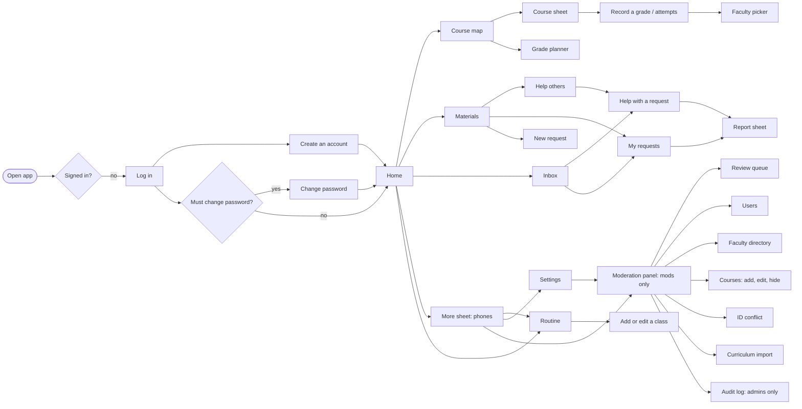

# Screens and flows (mobile-first)

The screen specification for the built app. It records each flow, what every screen shows, and its states (loading, empty, error) at phone width (390px). It replaces the planned Figma file: the screens were designed straight in code against [`DESIGN.md`](../DESIGN.md), so this document and the running app are the reference. Desktop (1440px) uses the same screens beside the left navigation rail.

Shared rules on every screen (from `PRODUCT.md` and `DESIGN.md`):

- Pocket Planner: neutral grounds, flat rounded surfaces, one accent per palette, course hues only on data, Figtree with Noto Sans Bengali, and shadows only on floating layers.
- Every action result and error is a toast. Inline text only for per-field validation. Moderation states use a persistent `StatusNote`.
- Touch targets are at least 44px. Everything works with the keyboard.
- Student IDs, emails and full names are never shown to other students.

## App flow

Navigation:

- **Main tabs.** On a phone, a floating pill bar with five slots: Home, Courses, Materials, Inbox (unread badge) and More. More opens a bottom sheet titled "More" with the rest, each row with an icon, a name and a one-line hint: Routine ("Your classes for the week"), Mod ("Held posts, users and curriculum", mods and admins only) and Settings ("Theme, password and account"). From `md`, a left rail lists Home, Courses, Materials, Routine, Inbox (unread badge), Mod (mods and admins only) and Settings; it is 240px wide when open and icons only when collapsed. Students never see Mod. The current tab is marked by `aria-current` and a sliding `brand-soft` pill on phones, and the pill sits on More while a screen from the More sheet is open (the sheet's current row is tinted and ticked, and screen readers hear "More, Routine open"); the rail uses a `brand-soft` active row. The bar slides away while scrolling down and returns on scrolling up. Home also links to the full routine, and moderation is also listed under Settings. The Mod tab stays marked while any `/mod/...` screen is open.
- **No tabs when they would lead nowhere.** Log in, Create an account and the forced Change password screen show only the wordmark; the tabs return once the user is signed in and has no temporary password.
- **Moderation sections.** From `md`: an underline tab row (Queue, Users, Faculty, Courses, ID check, Audit log for admins, Import). On a phone seven sections do not fit a row, so the screen shows "Moderation" with a button naming the current section; it opens a bottom sheet listing every section the role can open, each with a one-line hint. The current row is tinted and ticked (`aria-current="page"`), and choosing a row closes the sheet.
- **Back paths.** Mod sections are peers of one top-level panel, so they need no back. Change password, opened from Settings, shows "Settings" with a back chevron above its title (not while the change is forced). Sheets (course sheet, pickers, mod sheets) close with their X, Esc or a tap on the scrim.

App-wide states: "You're offline" full screen with Retry when there is no connection; "A new version is ready" toast with a reload action after an update; an "Add to Home Screen" hint on iOS Safari that can be dismissed.

## Log in and sign up (Phase 2)

### Log in (`/login`)

| Element      | Notes                                                              |
| ------------ | ------------------------------------------------------------------ |
| Title        | "Log in"                                                           |
| Fields       | Username, Password                                                 |
| Primary      | Log in                                                             |
| Secondary    | Link to "Create an account"                                        |
| Errors       | Wrong username or password, rate limited, banned: one toast each   |
| After log in | Home, or Change password when `must_change_password` is set (FR-6) |

### Create an account (`/signup`)

| Field          | Notes                                                                                          |
| -------------- | ---------------------------------------------------------------------------------------------- |
| Username       | 3 to 20 lowercase letters, digits, underscore. Shown to others.                                |
| Full name      | Helper: "Private. Other students never see it."                                                |
| NSU email      | Must end in `@northsouth.edu`. Helper: "Private. Other students never see it."                 |
| NSU student ID | Placeholder `221 1234 042`; spaces and dashes are fine. Inline error names the problem (FR-2). |
| Password       | 8 to 128 characters                                                                            |

Primary: Create account. Errors: ID already registered (with a pointer to ask a mod, see the ID conflict flow), username taken, signup limit reached. Validation runs from the shared Zod schema, field by field.

### Change password (`/change-password`)

Current password and New password. Reached by choice from Settings, or forced after a mod reset or on the seeded admin's first login; while forced, every other screen redirects here.

## Course map (Phase 4)

### Home (`/`)

- Header and degree summary (CGPA, earned and remaining credits, a 14px credit bar). When a routine exists, the next class or in-progress class leads the summary; Today’s timeline follows.
- "Unlocked next" with its count and a "Course map" link: the first six courses whose prerequisites are now met, each with its state mark. When there are more, a muted "Showing 6 of 12" line ends the list.
- Empty: "No course map for your program yet. It will show up here once a moderator adds it. Your progress starts counting then."
- Error: "Couldn't load your progress. Check your connection and try again."

### Course map (`/courses`)

- Header "Course map" with the CGPA summary.
- Degree credits (earned of required, with any credits over the total) and a credit bar, then a "Categories" jump list: each category with its earned and required credits and its own credit bar (names come from the curriculum file, such as General Education, Math & Science, Major Core). Below it, one hairline list per category.
- Each row: state mark, code, title, credits. **Choice slots:** a slot that accepts more than one course shows every code joined with "/" (the slot code first, then its alternatives, for example `ENG115/BEN205`) and the titles joined with " / ", wrapping onto two lines at 390px, until the student records an attempt on one of them. After that the row shows that course's code and title. If several of the codes have attempts, the course that counts is shown: a passing attempt over a failed one, then the better best grade, then the most recent attempt. Lab slots (`CSE115L`) work the same way. "Unlocked next" on Home and the course sheet header use the same label. A course a moderator has hidden is not in the list, unless the student already has a grade on it. State marks are shape-coded, never colour alone: filled = done, hollow = available, struck = locked, half = waived. A "Can retake" tag shows where the retake policy allows it.
- "Your extra courses" section lists the student's own electives and extras; excluded ones carry an "Excluded" tag.
- "Add a course" opens the student course form: Course code (cannot change once added), Title, Credits, Category, "Exclude from transcript". Helper: "It fills the next open elective in its category."
- **Elective trails** (programs that list them, today CSE): the trail category carries one quiet line under its header: "Take at least 2 from one trail" until a trail has a done course, then "Artificial Intelligence: 1 of 2 done, 1 added", and "Trail met: Artificial Intelligence (2 of 2 done)" once a trail has the minimum. Empty elective rows there read "Pick from a trail" (elsewhere "Any discipline"), and "Add course" opens the **trail picker** sheet instead of the form: a search box (code or title), then each trail as a section with "n of 2 done", rows with a mark (plus = addable, filled = done, hollow = added), title, code and credits. Tapping an addable row adds that course to the category with a toast and closes the sheet; done and added rows are disabled and tagged "Done" or "Added". The footer "Course not listed? Add it yourself" opens the usual form, preset to the trail category; Cancel goes back to the picker.
- A category whose courses are all non-credit (CSE Internship) shows "Non-credit" instead of "0 / 0 cr", in the header and in the jump list.
- Student course form, open electives: typing a course code (after a short pause) looks it up in every imported curriculum and trail list. If found, an empty Title and Credits are filled and the code field says "Found: Principles of Economics, 3 cr"; typed values are never overwritten and an unknown code says nothing. Outside the trail category the Category field carries the hint "Any course from any discipline. A course like one you already took won't count."
- Empty: "No course map for your program yet".

### Course sheet

A bottom sheet on phone, side panel on desktop, opened from any course row.

- Code, title, credits, "Non-credit" tag when it applies, the prerequisite rule in words, and "Or take instead" alternatives. For a choice slot the header shows the joined codes and titles until one is taken; afterwards it shows the course taken, and the list is titled "Other choices for this slot".
- Locked course: "You haven't met the prerequisites yet." Recording a grade still works (students fix data that way).
- Waiving: record the grade "WV". The course counts as done and earns credits, never affects CGPA, and shows the half mark.
- Own courses add Edit and "Delete course".

## CGPA and attempts (Phase 6)

Inside the course sheet, under "Your attempts":

| State       | What shows                                                                                                  |
| ----------- | ----------------------------------------------------------------------------------------------------------- |
| No attempts | "Record a grade": quick form with Grade only ("Pick a grade"), and "Add term and faculty" for the full form |
| Attempts    | One row per attempt: grade, term, faculty; the counting one is tagged "Best"; Edit and "Delete attempt"     |
| Retake      | "Retake allowed" or "Retake not allowed" from the retake policy                                             |
| Add another | "Add an attempt" opens the full form                                                                        |
| Loading     | "Loading your attempts..."                                                                                  |
| Error       | "Your attempts did not load. You can still record a grade."                                                 |

Grade choices are compact selectable chips; the selected grade uses `brand-soft` and `brand-ink`. Full attempt form: Course, Grade, Term (optional, "Pick the term you took it in."), Faculty (optional; a picker, see below; the list loads when the picker opens; if it fails to load the sheet says so with a Retry, and the student can still choose "No faculty" and save). Buttons: "Record a grade" (quick), "Save attempt" (new), "Save changes" (edit). Toasts: "Grade saved", "Attempt updated", "Attempt deleted".

**Faculty picker.** The Faculty field is a button showing the chosen "Name (INITIALS)" or "No faculty". Tapping it opens a bottom sheet (centred on desktop) titled "Who taught it?" with a search box ("Search by name or initials", focused on open), a department filter ("All departments" or one department) and a hairline list. The first row is "No faculty". Each row shows the name with initials in brackets (no brackets when the person has none) and a muted line "designation · department". The chosen row is tinted and ticked. The search is sent to the server a moment after typing pauses and covers the whole directory, not only the rows on screen; a new search or department starts again from the first page. Search matches the start of any name word, or the start of the initials, without regard to case or accents, and ignores titles like "Dr."; exact initials rank first. Empty result: "No faculty match that search." Keyboard: type, Arrow up/down to move, Enter to pick, Esc to close. The list shows a page at a time with a "Show more" button. A faculty member a moderator has hidden is not in the list, but an attempt that already names them keeps showing the name. Attempt rows show "Name (INITIALS)".

CGPA summary (Home and Course map): the CGPA to two decimals, or "No CGPA yet"; Earned and Remaining credits; a credit bar; "Every category has its credits." once nothing remains. Only the student sees their attempts and CGPA; mods cannot.

## Class routine (Phase 9)

Everyone has their own routine, mods and admins included (they reach it from Home, since the Mod tab takes the Routine tab's place). Nobody else ever sees a user's routine, mods and admins included, and it is never used for notifications. Times are Asia/Dhaka.

### Home: next class and Today

- **Summary panel.** While a class is on, it reads "In class now" with the minutes left ("left in this class"); otherwise, if a class is still to come today, "Next class" with the minutes until it starts ("until it starts"). Below: the course code and title, the time range, and "Section 2 · Room 304 · RkZ". With no class left today, or no routine, the panel shows the degree standing as before (credits, credit bar, "Record a grade"). While the routine loads, a flat placeholder holds the panel's place so it does not swap.
- **Today.** A section header "Today" with a "Full routine" link, then today's classes in time order on a time rail: start and end on the left, a hairline, then the course, title and details. The class in progress sits on a `brand-soft` row marked "Now"; finished classes are in `faint` ink (and say "Finished" to screen readers), so neither state is colour alone. The clock refreshes every 30 seconds and when the app comes back to the foreground.
- Empty (no routine): "Add the classes you're taking this term and today's will show up here." with an "Add your routine" link. No class today: "No classes today." Loading: two flat placeholder rows. Error: "Today's classes didn't load. Check your connection and try again." with Retry.

### Routine (`/routine`)

A calendar of the current term, like a phone's calendar app, with Month, Week and Day views. The routine repeats every week of the term, so each date shows the classes held on its weekday. The view and date are in the URL (`?view=month&date=2026-10-21`); Week and today are the defaults.

- Header "Routine" with the current term (for example "Fall 2026") and the one primary button, "Add class".
- A row with the view switch (Month · Week · Day, a segmented control) and "Today" (disabled while today is shown). Under it the period on screen ("October 2026", "Oct 18 - 24", "Wednesday, Oct 21") with back and forward arrows: a month, a week or a day at a time.
- **Week** (the default): a time grid, Sunday to Saturday, 8 AM to 6 PM (wider when a class starts earlier or ends later), one hairline per hour. Each column header shows the weekday and date; today's date sits on a `brand-soft` chip, and tapping a header opens that day. Classes are rounded course-hue blocks at their times: the code (and on wider screens the time and room); classes on now use the shared current-state styling, finished ones are faint, and a thin brand line marks the current time in today's column. Classes that clash share their slot side by side; on a phone those narrow blocks drop their text, and the full label is read out and shown in the sheet. Tapping a block opens Edit class; tapping an empty slot opens "Add a class" with that day and time filled in (a 90-minute class from the nearest half hour).
- **Day**: the same grid for one date, with each block showing the code and title, the time range and "Section 2 · Room 304 · RkZ".
- **Month**: whole weeks covering the month, Sunday first. Each date shows its classes: on wider screens up to three as "8:00 AM CSE115" with "N more" after, on a phone one short course-hue bar per class. Other months' dates are faint; today's date uses the brand accent. Tapping a date opens it in Day.
- Dates outside the term have no classes; a day outside it says "This day is outside Fall 2026, so it has no classes." Term dates come from the shared term start dates until moderators can set each term's start and end.
- No classes at all: "No classes yet. Add the ones you're taking this term, or tap an empty slot on the grid." A day with none: "No classes this day."
- "Clear this term" (only when there are classes) asks first: "Clear this term's routine?" / "This deletes all N classes from this term. It can't be undone." with "Keep them" and "Clear routine". Toast "Routine cleared".
- Loading: a flat placeholder at the grid's size. Error: "Your routine didn't load" with the reason and "Try again".

### Class sheet

A bottom sheet titled "Add a class" or "Edit class", with "Times are Dhaka time. Only you can see your routine."

| Field              | Notes                                                                                                                                                                                                                                                                                                                                                                                                                                                                                                                                                                                                                                     |
| ------------------ | ----------------------------------------------------------------------------------------------------------------------------------------------------------------------------------------------------------------------------------------------------------------------------------------------------------------------------------------------------------------------------------------------------------------------------------------------------------------------------------------------------------------------------------------------------------------------------------------------------------------------------------------- |
| Course             | A field showing the chosen code and title ("Pick a course" when empty). It opens a sheet, "Which course is this class?", with a search box ("Search by code or title", focused) over the student's curriculum courses, alternatives and own courses. Each row shows its state mark, code and title; courses the student can take now come first, then locked ones, then done ones. Search matches a code with or without spaces ("cse 2", "cse225", "115") or the start of title words ("data struct"). Arrow keys and Enter pick; "No course matches that search." when nothing does. A saved class whose course left the list keeps it. |
| Section            | A number, 1 to 99                                                                                                                                                                                                                                                                                                                                                                                                                                                                                                                                                                                                                         |
| Days               | Seven toggles with the letters NSU prints: S M T W R F A. Helper: "The letters NSU prints: S is Sunday, R is Thursday, A is Saturday." "Pick at least one day" when none                                                                                                                                                                                                                                                                                                                                                                                                                                                                  |
| Starts, Ends       | Times; "Pick a start time", "Pick an end time"; the end must be after the start                                                                                                                                                                                                                                                                                                                                                                                                                                                                                                                                                           |
| Room (optional)    | Free text as printed on the NSU routine                                                                                                                                                                                                                                                                                                                                                                                                                                                                                                                                                                                                   |
| Faculty (optional) | Faculty initials as printed on the NSU routine, free text (not the faculty picker)                                                                                                                                                                                                                                                                                                                                                                                                                                                                                                                                                        |

When the days and times clash with another class: "This overlaps another class. You can still save it." naming each clashing class, its days and its time. It never blocks saving; touching times (one ends at 10:00, the next starts at 10:00) are not a clash. Buttons: "Add class" / "Save changes"; on an existing class, "Delete class" asks "Delete this class from your routine?" first. Toasts: "Class added", "Class updated", "Class deleted".

## Moderation panel (Phases 7 and 8)

- **Review queue** (`/mod/queue`): "Review queue" with the waiting count. Tabs: Waiting, Handled, Dismissed. Waiting mixes held posts and open reports. A held post row shows the text (IDs and card numbers redacted), the author's username, the model category and confidence, "Rules that matched", and "The author asked a moderator to look at this." when it applies. Actions: Approve, Reject (category plus reason). Report rows: Mark handled or Dismiss with a note. Empty: "Nothing is waiting for you."
- **Users**: search by username prefix; rows show handle and state badges (Banned, Flagged); the user sheet offers Ban, Unban, Reset password and Clear flag, each with a reason.
- **Faculty** (`/mod/faculty`, mods and admins): "Faculty" with an "Add faculty" button. The same search and department filter as the picker, plus a "Show hidden" switch; the list is searched on the server and pages in with "Show more"; rows show name (initials), "designation · department" and a "Hidden" badge. Tapping a row (or "Add faculty") opens a sheet with Name, Initials (optional), Designation, Department and NSU page (optional); "Save changes" / "Add faculty". Taken initials show under Initials, a taken name under Name. Existing rows also have a Visibility section: a required reason and "Hide" (or "Show again" for a hidden row). Toasts: "Faculty added", "Faculty updated", "Faculty hidden", "Faculty shown again". Empty: "No faculty match that search." Every change is in the audit log; admins can reverse an edit or a hide.
- **Courses** (`/mod/courses`, mods and admins): "Courses" with a curriculum picker (program and version, from the imported curricula), an "Add course" button, a search box ("Search by code or title", which also matches alternatives) and a "Show hidden" switch (with the hidden count). The slots are listed by category in curriculum order; each row shows the title, the code (joined with its alternatives), "elective", the semester, the credits and a "Hidden" badge. Each category header has "Add here". Tapping a row opens a bottom sheet with Kind (course or elective placeholder), Code, Title, Credits (halves like 1.5), Non-credit, Category (pick one or "New category..."), Semester (optional), "Or take instead" (code and title pairs, added and removed one by one; courses only) and Prerequisites as text (`CSE215 and (MAT120 or MAT125)`, `60 credits completed`; empty for none). A text mistake or a prerequisite on a course the curriculum doesn't have shows under Prerequisites; a code already used by another slot shows under Code. Existing rows also have a Visibility section: a required reason and "Hide" (or "Show again"); a hidden course leaves students' maps unless they already have a grade on it, and grades are never deleted. Toasts: "Course added", "Course updated", "Course hidden", "Course shown again". Empty: "No courses found". Every change is in the audit log; admins can reverse an edit, a hide or a show.
- **ID conflict**, **Curriculum import** and **Audit log** (admins: filter, Reverse) as described in [`moderation-flow.md`](moderation-flow.md). When the chosen file's program and version are already imported, the import screen shows a note: "Importing replaces every course of this version, including changes made in the Courses screen." The intro text says the same.

Flows for screening and the queue are in [`screening-flow.md`](screening-flow.md).

## Grade planner (Phase 9b)

A third view in Courses where a student sets a target CGPA, tries mock grades and reads advice on whether the remaining courses reach it or a few retakes are worth paying for. It is private to the student, and the advice is arithmetic on their own grades, never a promise. How the advice is worked out is in [`planner-flow.md`](planner-flow.md).

### Planner (`/courses?view=planner`)

- **View switch.** The Courses header has a segmented switch: List and Planner on a phone; List, Planner and Roadmap from `md`. The view is in the URL (`?view=planner`).
- **Layout.** On a phone the CGPA and target panel comes first, then the tabs. From `xl` the panel is a 360px column beside the tabs.
- Loading: a flat placeholder panel and four placeholder rows. Error: "Couldn't load your grades" / "The planner needs them. Check your connection and try again." with Retry.

### Your CGPA and target

| Element         | Notes                                                                                                                                                                                                                                  |
| --------------- | -------------------------------------------------------------------------------------------------------------------------------------------------------------------------------------------------------------------------------------- |
| Title           | "Your CGPA", with an "At target today" badge once the real CGPA is at or above the target                                                                                                                                              |
| Current         | The CGPA to two decimals, or "–" with the note "No grades yet"                                                                                                                                                                         |
| Projected       | The CGPA with the mock grades, with the note "With 2 mock grades" (or "With 1 mock grade"). Equal to Current when there are no mocks                                                                                                   |
| Target CGPA     | A text field with a decimal keypad, placeholder `3.50`, and the button "Save target". Helper: "From 0.01 to 4.00, above your CGPA." while no target is saved, "Set a higher target to keep going." once it is reached                  |
| Field errors    | "Enter a number between 0.01 and 4.00." and "Use at most two decimal places." from the shared schema; from the server "Your CGPA is already 3.35. Set a target above it." Any other error is a toast. Toast on success: "Target saved" |
| Target problems | Loading: two flat placeholder bars. Error: "Your target did not load." with "Try again"                                                                                                                                                |

### Tabs

A tab row under the panel: **Advice**, **Retakes** (with its row count) and **Upcoming** (with its row count). Retakes and Upcoming appear only while they have rows; if the open list empties, the screen falls back to Advice.

**Advice**

- Title for the outcome: "Target reached" or "Reached with your mock grades", "Too early to call", "No retakes needed", "One retake would help" or "A few retakes would help", "A stretch", "Out of reach" or "Too many retakes needed", then one short sentence ("On track without retakes.", "Retaking 2 courses gets you there.").
- Hairline rows: "Predicted at graduation", "Needed in your remaining N credits" ("over 4.00" above 4.00, "Any passing grade" at or below 0) and "Your usual average there". Out of reach adds "Best case" and "Straight A's". Too early and reached show no rows.
- "Suggested retakes" (or "Retakes that help most" when out of reach): one row per course with the state mark, code, title, credits and the move, such as `D → C+` (read out as "D to C+").
- Foot: what the predictions rest on ("Predicted from your grades by category (average 3.22)." or "Rough until you have 8 graded courses (2 so far). Best case assumes A-." or, while too early, "Predictions start at 8 graded courses (2 so far).") and "Estimates only. Retake rules and fees are set by NSU."
- No target: "Set a target CGPA to see what you need." While the target loads: two placeholder lines. If it failed: "No advice until your target loads."

**Retakes** and **Upcoming**

- A line "Try a grade on any course. Mocks stay on this device." and, once any mock is set, "Clear mock grades".
- One hairline list. Each row: state mark, code, title, "3 cr · best D" (or "3 cr · General Education" for a course with no grade yet), a grade picker (No mock, then A to F) and, once picked, a "Mock" badge on a `brand-soft` row. Under a mocked past course: "Retake: D becomes B." or "No change: your best stays B+." Mocks stay in this browser, per account and curriculum version, and never change anything outside the planner.
- **Retakes** lists graded courses a retake is allowed on (best grade below B+), worst grade first, with "2 courses hidden: already B+ or better." under the list. **Upcoming** lists every unfinished credit-bearing slot, including elective slots with no course picked, each taking a first-attempt mock; a required course that only has an F reads "best F".
- A list opens on its first 10 rows plus any row with a mock; "Show all 24" shows the rest.
- Nothing left: "Nothing left to plan", under the advice panel.

## Materials (Phase 10)

Students ask for course materials and send each other links. UniLink hosts no files. Only the student who asked can see a link. Times are Asia/Dhaka. The flow is in [`resource-flow.md`](resource-flow.md).

### Materials (`/resources`)

- Header "Materials" with "Ask for notes, or send them to someone who asked." and the button "New request".
- A tab row: **Help others** (with a count of requests the student has not answered yet) and **My requests**. My requests is the default; `?tab=help` opens Help others. Switching tabs replaces the URL entry, so Back leaves the screen.

**Help others**

- One flat panel of hairline rows. Each row: the course chip and the faculty name ("Name (INITIALS)"), the note (two lines at most), then a line with a "Same faculty" tag when the student had that faculty member, the time left ("3 days left", "Under an hour left") and "You sent a link" or "You sent 2 links". A chevron ends the row; tapping it opens the request screen.
- Order: same faculty first, then the soonest to expire. At most 50 rows. It lists open requests for any course the student has recorded (whichever faculty member taught it) and faculty-only requests for a faculty member the student had. It never shows who asked or any link.
- Empty: "Nothing to help with right now." / "Requests for courses you've recorded show up here." Loading: three placeholder rows. Error: "Requests didn't load" with Retry.

**My requests**

- Under the tabs, a line with an info icon: "A request that expires without an accepted link is deleted. Once you accept a link, the request and its links are deleted 3 months later. Save what you need before then."
- One flat panel per request, newest first, 20 at a time with "Show older". The head shows the course chip and the faculty name, a state badge (Open, Fulfilled, Expired), the note and an expiry line: "3 days left. Expires 20 Nov, 6:00 pm, then it is deleted.", "Fulfilled 12 Nov. Deleted on 10 Feb." or "Expired 5 Nov. It is deleted automatically."
- A request that is not published shows a status note: "Waiting for a moderator. Your request is shown to others once it is approved." or "A moderator didn't approve this request."
- Under the head, one hairline row per link: the sender's username, a line "Took it with the same faculty" or "Different faculty, or not recorded" (only when the request names a faculty member), the time since it was sent, the sender's note, then the buttons. "Open on drive.google.com" opens the link in a new tab (named for its host, `noopener noreferrer nofollow`). While the request is open and the link is undecided there are "Accept" and "Turn down"; otherwise an "Accepted" or "Turned down" badge. Every link has a "Report" button.
- With no links: "No links yet. You'll get a notification when one arrives." (open) or "No links were sent."
- **Accept** opens a confirm sheet, "Accept this link": "Accepting closes your request. You can't change your mind afterwards.", "Sent by `username`", and three effects: no more links can be sent, the sender is told, and the request and its links are deleted 3 months from now. Button "Accept link", toast "Link accepted. Thanks for closing the loop." **Turn down** acts at once: toast "Link turned down".
- Empty: "No requests yet." / "Ask for a course's notes and students who took it are told." with "New request". Loading: a flat placeholder panel. Error: "Your requests didn't load" with Retry.

### New request (`/resources/new`)

Title "New request", "Ask other students for materials." One form on a flat panel.

| Field                                | Notes                                                                                                                                                                                                            |
| ------------------------------------ | ---------------------------------------------------------------------------------------------------------------------------------------------------------------------------------------------------------------- |
| Course (optional)                    | A button showing the chosen code ("Any course" when empty) that opens the course picker "Which course?" over the courses on the student's own course map; an X button clears it                                  |
| Faculty (optional)                   | The faculty picker, "Which faculty member?". Helper under it: "Pick a course, a faculty member, or both. Students who took what you pick are told." With neither: "A request needs a course, a faculty, or both" |
| What are you looking for? (optional) | A text box, placeholder "Midterm notes, past papers, lecture slides", with a counter "0 / 300"                                                                                                                   |
| Keep it open for                     | Five choices: 1 day, 3 days, 7 days (the default), 14 days, 1 month. Helper: the two deletion sentences from My requests                                                                                         |

Buttons: "Post request" and "Cancel" (both return to Materials). Toasts: "Request posted. You'll get a notification when someone sends a link." or, when held, "Request saved. It goes out once a moderator approves it." A refused post is a toast with the server's sentence: the daily limit, "You can have 10 open requests at a time.", or, for a new account, the title "New accounts can't post yet" with how long to wait.

### Help with a request (`/resources/:id`)

Reached from a notification ("A student is looking for a resource") or a row on Help others.

- Title "Help with a request". The request in a flat panel (course chip, faculty, note, expiry line), then "Only the student who asked can open your link, and they see your username next to it."
- **Send a link** form: Link (a URL field, placeholder `https://drive.google.com/...`; helper "Any https link: Google Drive, YouTube, Samsung Cloud, transfer.it and so on. Make sure anyone with the link can open it."; errors "Use a full https link to a public website" and "Link shorteners aren't allowed. Paste the full link instead") and Note (optional, placeholder "What is in it, for example Midterm notes, Spring 2026", counter "0 / 300"). Button "Send link". Toast "Link sent. You'll get a notification if it is accepted." or, when held, "Link saved. It goes to the student once a moderator approves it." A refused send is a toast with the server's sentence ("You can't send a link to your own request.", "This request is no longer open.", "This request can't take another link from you.", or the new-account wait).
- **Your links**: the student's own links to this request, each with the host, the time since, the note, a badge (Sent, Accepted, Turned down) and, when held or not approved, the same status note as above. Never anyone else's link.
- A ghost button "Report this request" opens the report sheet.
- Closed (fulfilled, expired, held or removed, or an id that does not exist): "This request is closed." / "It was fulfilled, it expired or it was removed. Thanks for looking." with "Back to inbox". Opening your own request goes to My requests. Loading: a flat placeholder panel. Error: "The request didn't load" with Retry.

### Report sheet

A bottom sheet titled "Report this request" or "Report this link", with "Say what is wrong, such as a link that isn't what it claims or a request that breaks the rules. Moderators read every report." One field, "What is wrong" (3 to 300 characters, the shared reason rule), and the buttons "Send report" and "Cancel". Toast "Report sent. A moderator will take a look." A second open report from the same student on the same target is refused with "You already reported this." The report reaches the review queue, where a request is labelled by course and faculty and a link by its address.

### Notifications

| Inbox row                              | Opens                                |
| -------------------------------------- | ------------------------------------ |
| "A student is looking for a resource"  | Help with a request                  |
| "Someone sent a link for your request" | My requests                          |
| "Your link was accepted"               | Nothing: the row is only marked read |
