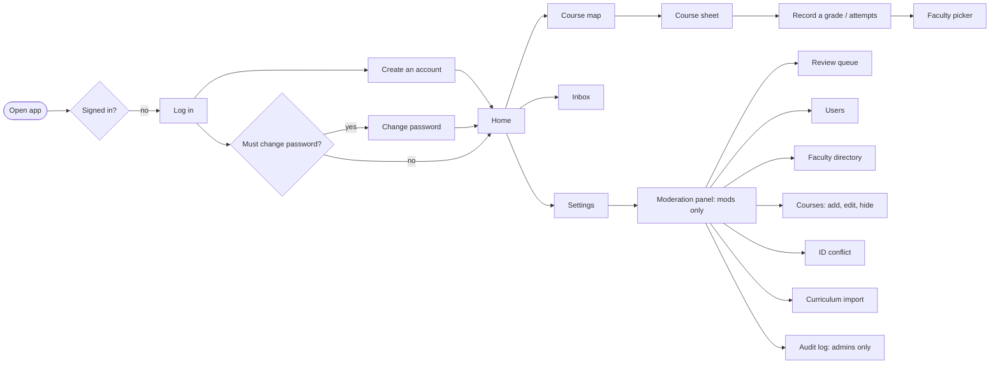

# Screens and flows (mobile-first)

The screen specification for what is built through Phase 8. It records each flow, what every screen shows, and its states (loading, empty, error) at phone width (390px). It replaces the planned Figma file: the screens were designed straight in code against [`DESIGN.md`](../DESIGN.md), so this document and the running app are the reference. Desktop (1440px) uses the same screens in a wider centred column, with the bottom bar moved into the top header.

Shared rules on every screen (from `PRODUCT.md` and `DESIGN.md`):

- Quiet Utility: neutral grounds, hairline-separated lists, one accent per palette, no gradients, glass or resting shadows. Geist, with Noto Sans Bengali for Bangla.
- Every action result and error is a toast. Inline text only for per-field validation. Moderation states use a persistent `StatusNote`.
- Touch targets are at least 44px. Everything works with the keyboard.
- Student IDs, emails and full names are never shown to other students.

## App flow

Navigation:

- **Main tabs.** A bottom bar on phones, the top bar from `md`: Home, Courses, Inbox (unread badge), Settings. Mods and admins get a fifth tab, Mod, for the moderation panel (it stays marked while any `/mod/...` screen is open); the bar never goes past five. Students never see it. The current tab is marked by `aria-current` and heavier ink. Moderation is also still listed under Settings.
- **No tabs when they would lead nowhere.** Log in, Create an account and the forced Change password screen show only the wordmark; the tabs return once the user is signed in and has no temporary password.
- **Moderation sections.** From `md`: an underline tab row (Queue, Users, Faculty, Courses, ID check, Audit log for admins, Import). On a phone seven sections do not fit a row, so the screen shows "Moderation" with a button naming the current section; it opens a bottom sheet listing every section the role can open, each with a one-line hint. The current row is tinted and ticked (`aria-current="page"`), and choosing a row closes the sheet.
- **Back paths.** Mod sections are peers of one top-level panel, so they need no back. Change password, opened from Settings, shows "Settings" with a back chevron above its title (not while the change is forced). Sheets (course sheet, pickers, mod sheets) close with their X, Esc or a tap on the scrim.

App-wide states: "You're offline" full screen with Retry when there is no connection; "A new version is ready" toast with a reload action after an update; an "Add to Home Screen" hint on iOS Safari that can be dismissed.

## Log in and sign up (Phase 2)

### Log in (`/login`)

| Element      | Notes                                                              |
| ------------ | ------------------------------------------------------------------ |
| Title        | "Log in"                                                           |
| Fields       | Username, Password                                                 |
| Primary      | Log in                                                             |
| Secondary    | Link to "Create an account"                                        |
| Errors       | Wrong username or password, rate limited, banned: one toast each   |
| After log in | Home, or Change password when `must_change_password` is set (FR-6) |

### Create an account (`/signup`)

| Field          | Notes                                                                                          |
| -------------- | ---------------------------------------------------------------------------------------------- |
| Username       | 3 to 20 lowercase letters, digits, underscore. Shown to others.                                |
| Full name      | Helper: "Private. Other students never see it."                                                |
| NSU email      | Must end in `@northsouth.edu`. Helper: "Private. Other students never see it."                 |
| NSU student ID | Placeholder `221 1234 042`; spaces and dashes are fine. Inline error names the problem (FR-2). |
| Password       | 8 to 128 characters                                                                            |

Primary: Create account. Errors: ID already registered (with a pointer to ask a mod, see the ID conflict flow), username taken, signup limit reached. Validation runs from the shared Zod schema, field by field.

### Change password (`/change-password`)

Current password and New password. Reached by choice from Settings, or forced after a mod reset or on the seeded admin's first login; while forced, every other screen redirects here.

## Course map (Phase 4)

### Home (`/`)

- "Welcome to UniLink" header with the CGPA summary (CGPA, earned and remaining credits, a credit bar).
- "Unlocked next": the courses whose prerequisites are now met, each with its state mark, linking to the course sheet.
- Empty: "No course map for your program yet. It will show up here once a moderator adds it. Your progress starts counting then."
- Error: "Couldn't load your progress. Check your connection and try again."

### Course map (`/courses`)

- Header "Course map" with the CGPA summary.
- Degree credits (earned of required, with any credits over the total) and a credit bar, then a "Categories" jump list: each category with its earned and required credits and its own credit bar (names come from the curriculum file, such as General Education, Math & Science, Major Core). Below it, one hairline list per category.
- Each row: state mark, code, title, credits. **Choice slots:** a slot that accepts more than one course shows every code joined with "/" (the slot code first, then its alternatives, for example `ENG115/BEN205`) and the titles joined with " / ", wrapping onto two lines at 390px, until the student records an attempt on one of them. After that the row shows that course's code and title. If several of the codes have attempts, the course that counts is shown: a passing attempt over a failed one, then the better best grade, then the most recent attempt. Lab slots (`CSE115L`) work the same way. "Unlocked next" on Home and the course sheet header use the same label. A course a moderator has hidden is not in the list, unless the student already has a grade on it. State marks are shape-coded, never colour alone: filled = done, hollow = available, struck = locked, half = waived. A "Can retake" tag shows where the retake policy allows it.
- "Your extra courses" section lists the student's own electives and extras; excluded ones carry an "Excluded" tag.
- "Add a course" opens the student course form: Course code (cannot change once added), Title, Credits, Category, "Exclude from transcript". Helper: "It fills the next open elective in its category."
- Empty: "No course map for your program yet".

### Course sheet

A bottom sheet on phone, side panel on desktop, opened from any course row.

- Code, title, credits, "Non-credit" tag when it applies, the prerequisite rule in words, and "Or take instead" alternatives. For a choice slot the header shows the joined codes and titles until one is taken; afterwards it shows the course taken, and the list is titled "Other choices for this slot".
- Locked course: "You haven't met the prerequisites yet." Recording a grade still works (students fix data that way).
- Waiving: record the grade "WV". The course counts as done and earns credits, never affects CGPA, and shows the half mark.
- Own courses add Edit and "Delete course".

## CGPA and attempts (Phase 6)

Inside the course sheet, under "Your attempts":

| State       | What shows                                                                                                  |
| ----------- | ----------------------------------------------------------------------------------------------------------- |
| No attempts | "Record a grade": quick form with Grade only ("Pick a grade"), and "Add term and faculty" for the full form |
| Attempts    | One row per attempt: grade, term, faculty; the counting one is tagged "Best"; Edit and "Delete attempt"     |
| Retake      | "Retake allowed" or "Retake not allowed" from the retake policy                                             |
| Add another | "Add an attempt" opens the full form                                                                        |
| Loading     | "Loading your attempts..."                                                                                  |
| Error       | "Your attempts did not load. You can still record a grade."                                                 |

Full attempt form: Course, Grade, Term (optional, "Pick the term you took it in."), Faculty (optional; a picker, see below; if the list fails to load the control is disabled and a toast says "The faculty list did not load. You can save without it."). Buttons: "Save grade" (quick), "Save attempt" (new), "Save changes" (edit). Toasts: "Grade saved", "Attempt updated", "Attempt deleted".

**Faculty picker.** The Faculty field is a button showing the chosen "Name (INITIALS)" or "No faculty". Tapping it opens a bottom sheet (centred on desktop) titled "Who taught it?" with a search box ("Search by name or initials", focused on open), a department filter ("All departments" or one department) and a hairline list. The first row is "No faculty". Each row shows the name with initials in brackets (no brackets when the person has none) and a muted line "designation · department". The chosen row is tinted and ticked. Search matches the start of any name word, or the start of the initials, without regard to case or accents, and ignores titles like "Dr."; exact initials rank first. Empty result: "No faculty match that search." Keyboard: type, Arrow up/down to move, Enter to pick, Esc to close. The list is fetched once and searched in the browser. A faculty member a moderator has hidden is not in the list, but an attempt that already names them keeps showing the name. Attempt rows show "Name (INITIALS)".

CGPA summary (Home and Course map): the CGPA to two decimals, or "No CGPA yet"; Earned and Remaining credits; a credit bar; "Every category has its credits." once nothing remains. Only the student sees their attempts and CGPA; mods cannot.

## Moderation panel (Phases 7 and 8)

- **Review queue** (`/mod/queue`): "Review queue" with the waiting count. Tabs: Waiting, Handled, Dismissed. Waiting mixes held posts and open reports. A held post row shows the text (IDs and card numbers redacted), the author's username, the model category and confidence, "Rules that matched", and "The author asked a moderator to look at this." when it applies. Actions: Approve, Reject (category plus reason). Report rows: Mark handled or Dismiss with a note. Empty: "Nothing is waiting for you."
- **Users**: search by username prefix; rows show handle and state badges (Banned, Flagged); the user sheet offers Ban, Unban, Reset password and Clear flag, each with a reason.
- **Faculty** (`/mod/faculty`, mods and admins): "Faculty" with an "Add faculty" button. The same search and department filter as the picker, plus a "Show hidden" switch (with the hidden count); rows show name (initials), "designation · department" and a "Hidden" badge. Tapping a row (or "Add faculty") opens a sheet with Name, Initials (optional), Designation, Department and NSU page (optional); "Save changes" / "Add faculty". Taken initials show under Initials, a taken name under Name. Existing rows also have a Visibility section: a required reason and "Hide" (or "Show again" for a hidden row). Toasts: "Faculty added", "Faculty updated", "Faculty hidden", "Faculty shown again". Empty: "No faculty match that search." Every change is in the audit log; admins can reverse an edit or a hide.
- **Courses** (`/mod/courses`, mods and admins): "Courses" with a curriculum picker (program and version, from the imported curricula), an "Add course" button, a search box ("Search by code or title", which also matches alternatives) and a "Show hidden" switch (with the hidden count). The slots are listed by category in curriculum order; each row shows the title, the code (joined with its alternatives), "elective", the semester, the credits and a "Hidden" badge. Each category header has "Add here". Tapping a row opens a bottom sheet with Kind (course or elective placeholder), Code, Title, Credits (halves like 1.5), Non-credit, Category (pick one or "New category..."), Semester (optional), "Or take instead" (code and title pairs, added and removed one by one; courses only) and Prerequisites as text (`CSE215 and (MAT120 or MAT125)`, `60 credits completed`; empty for none). A text mistake or a prerequisite on a course the curriculum doesn't have shows under Prerequisites; a code already used by another slot shows under Code. Existing rows also have a Visibility section: a required reason and "Hide" (or "Show again"); a hidden course leaves students' maps unless they already have a grade on it, and grades are never deleted. Toasts: "Course added", "Course updated", "Course hidden", "Course shown again". Empty: "No courses found". Every change is in the audit log; admins can reverse an edit, a hide or a show.
- **ID conflict**, **Curriculum import** and **Audit log** (admins: filter, Reverse) as described in [`moderation-flow.md`](moderation-flow.md). When the chosen file's program and version are already imported, the import screen shows a note: "Importing replaces every course of this version, including changes made in the Courses screen." The intro text says the same.

Flows for screening and the queue are in [`screening-flow.md`](screening-flow.md).
