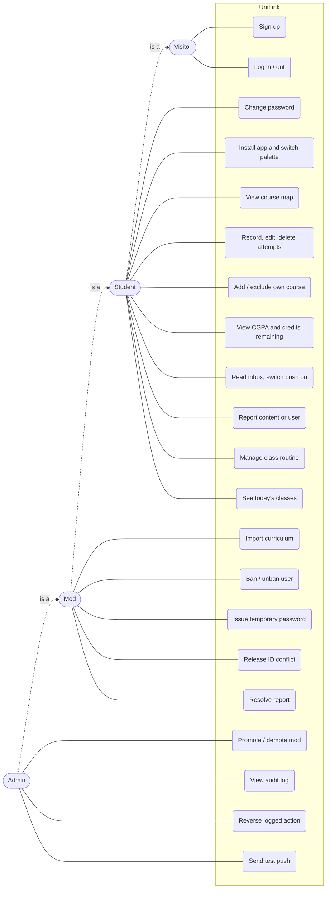

# Use cases (Phases 0 to 9)

## Use case diagram

Generalisation: a mod can do everything a student can, and an admin everything a mod can. Mods and admins still cannot read other students' attempts or CGPA (UC6, UC8 act on the caller's own data only). The routine (UC20, UC21) is the same: mods and admins keep their own but cannot read anyone else's.

## Use case descriptions

### UC1 Sign up (FR-1 to FR-3, FR-9)

- **Actor:** Visitor
- **Precondition:** Not signed in; under the signup limit for their IP.
- **Main flow:** Enter username, full name, NSU email, student ID, password. The system validates each field, derives key, suffix and admission year from the ID, hashes the password, creates the account and a session. The student lands on Home.
- **Alternatives:** Invalid field: inline error. ID key already registered: "this ID is already registered, contact a mod". Over the limit: 429.

### UC2 Log in / out (FR-4)

- **Main flow:** Enter username and password; the system sets the session cookie. Log out deletes the session (and the device's push subscription).
- **Alternatives:** Wrong credentials: generic error. Banned: refused. Over 10 attempts in 15 minutes: 429. `must_change_password` set: redirect to UC3.

### UC3 Change password (FR-5, FR-6)

- **Main flow:** Enter current and new password. The system replaces the hash, ends other sessions, clears `must_change_password`.

### UC5 View course map (FR-16, FR-17)

- **Main flow:** Open Courses. The system picks the curriculum by program code and admission year, marks each slot done, available or locked, and shows category and degree credit totals.
- **Alternative:** No curriculum for the program: empty state.

### UC6 Record an attempt (FR-18, FR-23 to FR-25)

- **Main flow:** Tap a course, choose grade, term and optional faculty. The system checks the retake rule, saves, and the map and CGPA update.
- **Alternative:** Best grade already B+ or above: the system refuses with a retake error.

### UC10 Report (FR-31)

- **Main flow:** Tap Report on a target, give a reason. The system stores an open report.
- **Alternatives:** Own target: refused. Already reported: 409. Over 10 per hour: 429.

### UC12 Ban a user (FR-33, FR-35, FR-37)

- **Actor:** Mod
- **Main flow:** Search the username, choose Ban, enter a reason. The system sets `banned_at`, deletes their sessions and writes an audit row with a snapshot.
- **Alternatives:** Target is an admin, a mod (for a mod actor) or the actor: 403. Already banned: 409.

### UC14 Release an ID conflict (FR-34)

- **Main flow:** A student cannot sign up because someone else holds their ID key. The mod looks up the key (logged), sees the holder's handle and state, and releases it with a reason. The holder is banned and the key is replaced by `released:<id>`, so the real owner can sign up.

### UC18 Reverse an action (FR-38)

- **Actor:** Admin
- **Main flow:** Open the audit log, choose a reversible row, enter a reason. The system restores the snapshot and writes its own audit row linked to the original.
- **Alternatives:** Not reversible (password reset, report resolution, ID lookup, a reversal): 409. Already reversed: 409. Released key since taken: 409. Target now an admin: 403.

### UC20 Manage class routine (FR-61 to FR-63, FR-65, FR-66)

- **Actor:** Student (mods and admins too, for their own routine)
- **Main flow:** Open Routine (mods and admins: "Full routine" on Home), tap "Add class", pick the course, section, days, start and end time, and optionally the room and faculty initials. The system saves it to the current term and shows it under each of its days.
- **Alternatives:** The times clash with another class that day: the form warns and the student can still save. End not after start, no day picked or a course outside the student's curriculum: refused. 40 classes in the term: 409. Edit or delete a class; clear the whole term after confirming. Another user's class: not found.

### UC21 See today's classes (FR-64)

- **Actor:** Student
- **Main flow:** Open Home. The system works out today in Asia/Dhaka, lists today's classes in time order with the current one highlighted and finished ones dimmed, and the summary panel shows the class in progress or the next one.
- **Alternatives:** No routine: a link to add one. No classes today: "No classes today." and the degree standing in the panel.
